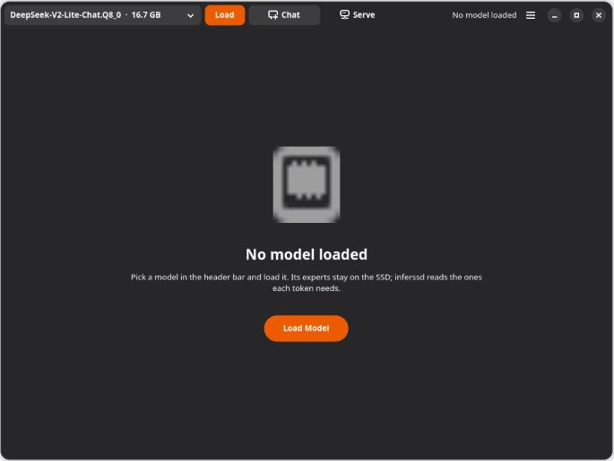
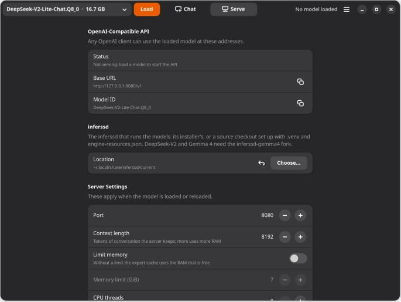

# InferSSD Studio

A small GNOME desktop app for [InferSSD](https://github.com/wici-ai/inferssd): load a mixture-of-experts (MoE)
model whose experts stay on your SSD, chat with it, and serve it to other apps over an OpenAI-compatible API.

> [!NOTE]
> **Unofficial.** InferSSD Studio is an independent project. It is not affiliated with or endorsed by WiCi AI, the
> authors of InferSSD. It runs the `inferssd` command you install separately and contains none of its code.

| Chat | Serve |
| --- | --- |
|  |  |

## Features

- **Models:** a picker lists the GGUF files in your model folders that inferssd can run (MoE models with routed
  experts), with their sizes. Load and Eject start and stop one inferssd server.
- **Chat:** the Chat tab is llama.cpp's chat app, served by the inferssd server, with conversation history,
  markdown and code rendering, regeneration and per-chat sampling settings.
- **Serve:** the Serve tab shows the OpenAI-compatible base URL and model ID with copy buttons, an example request
  in curl and Python, and the live server log. Its settings:
  - port, context length, an optional memory limit and CPU threads;
  - an optional API key, which the Chat tab receives automatically;
  - the disk prompt cache (off by default: it writes up to 16 GiB a model to your system drive);
  - serving on your local network, through a port forwarded to the server, which itself listens on localhost
    only. Set an API key first.
- Settings changed while a model is loaded take effect with one Reload. Closing the window stops the server.

## Requirements

- Linux with GTK 4.12 or later, libadwaita 1.6 or later, WebKitGTK 6.0 and PyGObject, for example Ubuntu 24.10 or
  later, or Fedora 41 or later:

  ```sh
  sudo apt install python3-gi gir1.2-gtk-4.0 gir1.2-adw-1 gir1.2-webkit-6.0   # Debian, Ubuntu
  sudo dnf install python3-gobject gtk4 libadwaita webkitgtk6.0              # Fedora
  ```

- **inferssd**, installed with its installer or built from source. The app finds it in the installer's location
  (`~/.local/share/inferssd/current`), in `$INFERSSD_DIR`, or in a folder you choose on the Serve tab; a source
  checkout qualifies when it has `.venv/bin/inferssd` and `engine-resources.json`, as inferssd's quick start sets
  up.
  - Upstream [wici-ai/inferssd](https://github.com/wici-ai/inferssd) runs DeepSeek-V4.1 and Muse Spark.
  - The [hammedrz/inferssd-gemma4](https://github.com/hammedrz/inferssd-gemma4) fork adds smaller models,
    DeepSeek-V2-Lite and Gemma 4 26B-A4B, and builds a CPU-only engine on Linux without CUDA:

    ```sh
    curl -fsSL https://raw.githubusercontent.com/hammedrz/inferssd-gemma4/main/scripts/install.sh | sh
    ```

## Install

```sh
git clone https://github.com/hammedrz/inferssd-studio.git
cd inferssd-studio
bash install.sh             # adds InferSSD Studio to your app grid
```

Or run it in place with `python3 inferssd_studio.py`. Remove the app-grid entry with `bash install.sh --uninstall`.

## Use

1. Put GGUF models in `~/.local/share/inferssd/models` (where `inferssd cli -hf` downloads them), or add their
   folder from the menu with **Add model folder…**.
2. Pick a model in the header bar and press **Load**. The first load on a machine also measures its CPU, memory
   and drive, which takes one to three minutes.
3. Chat on the **Chat** tab, or point an OpenAI client at the base URL on the **Serve** tab.

Shortcuts: <kbd>Ctrl</kbd>+<kbd>1</kbd> Chat, <kbd>Ctrl</kbd>+<kbd>2</kbd> Serve, <kbd>F5</kbd> refresh models.

## Files

| Path | Holds |
| --- | --- |
| `~/.config/inferssd-studio/settings.json` | Settings |
| `~/.local/share/inferssd-studio/runs/` | Each load's server run folder and `<run>.launcher.log`; the menu opens it |
| `~/.local/share/inferssd-studio/web-data/` | The Chat tab's conversation history, kept per server port |

## How it works

Each Load runs `inferssd launch --execute` with a runtime policy for this machine and the settings from the Serve
tab, and waits for the server's `/health`. Eject sends the launcher Ctrl+C, as in a terminal, and it stops its
server. The Chat tab is a WebKit view of the server's own chat page. Local network serving is a plain TCP
forwarder in the app, because inferssd's launcher binds the server to localhost.

To try the window without loading a model, set `INFERSSD_STUDIO_LAUNCHER` to a stand-in program that accepts
`inferssd launch`'s command line and serves `/health`.

## License

[MIT](LICENSE). inferssd is Apache-2.0 and the chat app is part of llama.cpp (MIT); both are installed separately
and keep their own licenses. Model weights remain under their publishers' licenses.
